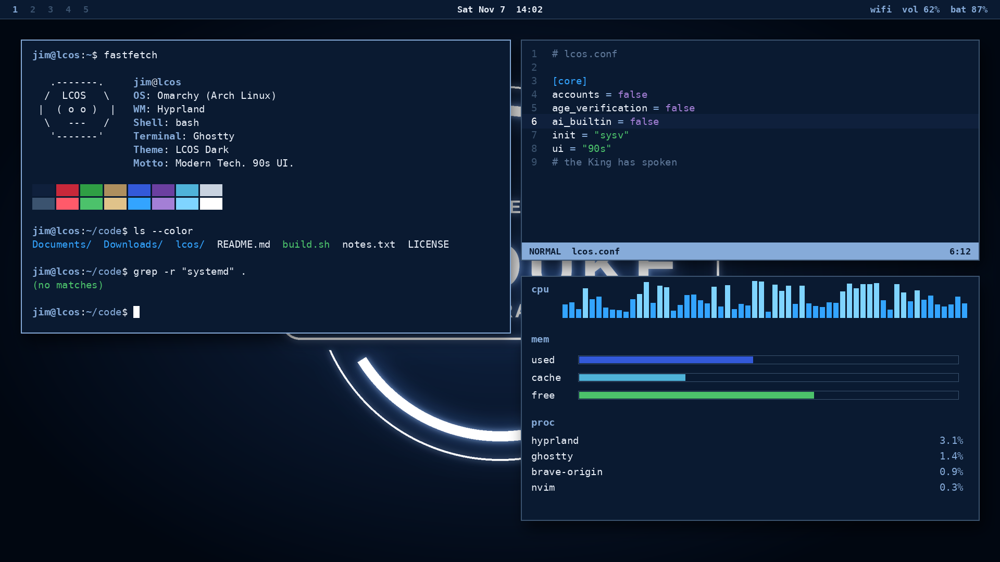

# LCOS Dark for Omarchy

The Lunduke Computer Operating System, after dark. Deep navy, white neon glow, title-bar blue. **Modern Tech. 90s UI.**



## Install

Copy, paste, done:

```bash
omarchy-theme-install https://github.com/jimaegirson/omarchy-theme-LCOS-dark/
```

Or from the Omarchy menu: `Super + Alt + Space` > Install > Style > Theme, then paste the repo URL.

### Manual install

```bash
git clone https://github.com/jimaegirson/omarchy-theme-LCOS-dark omarchy-theme-set lcos-dark
```

## Both variants

| Variant | Repo |
|---|---|
| Dark (navy) | omarchy-lcos-dark-theme |
| Light (grey, 90s) | omarchy-lcos-light-theme |

Both use the same navy neon wallpaper, like the real LCOS desktop.

## What's included

- `colors.toml`: palette sampled from official LCOS screenshots; drives the terminal, btop, Hyprland, Hyprlock, Mako, SwayOSD, Walker, Waybar and Chromium
- `backgrounds/`: neon-glow wallpaper (original homage, not the official logo art)
- `neovim.lua`: matching Neovim colors (delete it if it clashes with your setup)
- `icons.theme`: Yaru-blue
- `preview.png`

## Credits

Inspired by Bryan Lunduke's [LCOS](https://github.com/BryanLunduke/LCOS). Unofficial fan theme, not affiliated with Lunduke or Omarchy.

License: MIT
